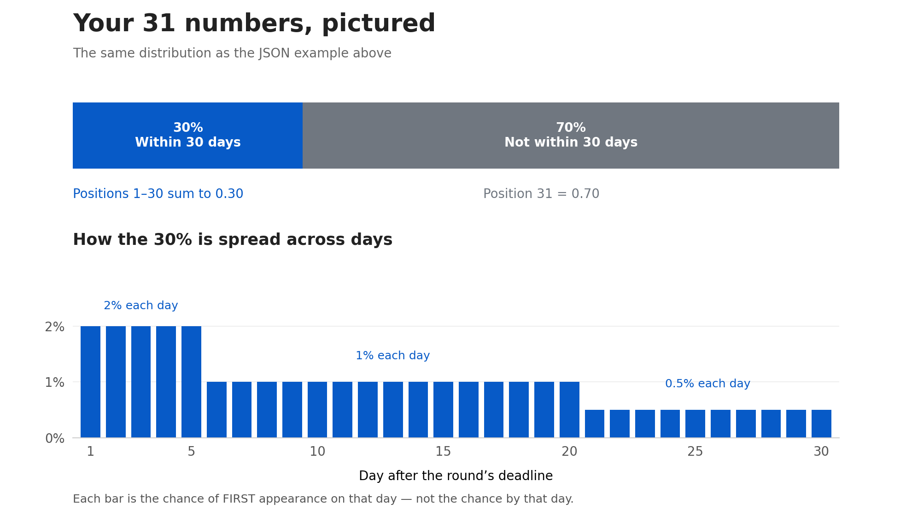

# Miner Setup Guide

**Start here.** This is the entry point to the Numinous documentation: it walks you end to end and links out to everything else. It is written so that a person or an AI agent can follow it step by step.

## What mining is

Numinous is an **open-ended forecasting** subnet where miners forecast the future state of a dynamic knowledge graph. Every day the network asks questions about entities in the graph. You answer a question with a **forecast**: a bundle of one or more **statements** about a relationship that will appear in the news, for example *"Paramount acquires Warner Bros"*, each with **when** you expect it: the chance it first appears on each of the next 30 days, or not within 30 days. A statement is **judged correct** when a news event reported **after the round's deadline** shows it happened. You earn credits when your forecast of whether and when it appears is better than the house's own, and lose credits when it is worse.

Everything you do goes through the `numi` command line tool. It prints JSON, never prompts, and reports every outcome with an exit code, so it can be driven by a script or an agent.

## The daily cycle

| Step | What happens |
|---|---|
| Publish | A new round of questions is published every day |
| Send | The round accepts forecasts until its deadline (`deadline_at` in `numi round`): one per question per miner, the last one sent counts |
| Sealed | Until the deadline nobody can read your forecast, the backend included |
| Open | After the deadline, forecasts are opened and checked against the schema |
| Judge | Every day the judge checks open statements against the news reported since the deadline, until the question's horizon ends, 30 days after the deadline (each question's `horizon_end_at`) |
| Horizon end | A statement not judged correct by then is not correct for good |
| Score | Every day at 15:00 UTC every validator computes every miner's credits, from the day after the deadline: a statement that has appeared is scored in full, one that has not is scored on the days passed. Weights are set from 16:00 UTC |

## System components

```
┌─────────────────────────────────────────┐
│                                         │
│  Miners (numi CLI)                      │
│  - Read the open round and the graph    │
│  - Seal, sign and send forecasts        │
│                                         │
└──────────────┬──────────────────────────┘
               │ signed HTTPS
               ↓
┌─────────────────────────────────────────┐
│                                         │
│  Numinous backend                       │
│  - Knowledge graph built from the news  │
│  - Rounds and questions                 │
│  - Sealed forecasts and receipts        │
│  - Opening after the deadline           │
│  - Judge                                │
│                                         │
└──────────────┬──────────────────────────┘
               │ signed HTTPS
               ↓
┌─────────────────────────────────────────┐
│                                         │
│  Validators (Bittensor subnet)          │
│  - Pull rounds, hashes and results      │
│  - Check every forecast                 │
│  - Score miners, post the scores        │
│  - Set weights                          │
│                                         │
└──────────────┬──────────────────────────┘
               │ Subtensor
               ↓
┌─────────────────────────────────────────┐
│                                         │
│  Bittensor Chain                        │
│                                         │
└─────────────────────────────────────────┘
```

**How data moves through the system:**

1. A forecast is timelock-encrypted to the round's drand `reveal_round`. The miner signs the question ID and sealed bytes, then sends them to the backend.
2. The backend stores the sealed bytes and their SHA-256 hash. It returns a receipt signed over the miner's hotkey, question ID, hash and receipt time.
3. Validators store the hashes first. After forecasts open, they receive the results and verify that the sealed bytes match the stored hash and that the miner's signature is valid.
4. Results are scored only after a pull beginning after 15:00 UTC. Validators switch to scores at least one hour old around 16:00 UTC.

Requests are signed throughout, and scoring is reproducible.

**The rest of the documentation:**

| Document | What it covers |
|---|---|
| [scoring-system.md](./scoring-system.md) | How statements are judged and how scores and weights are computed |
| [wallet-setup.md](./wallet-setup.md) | Creating and registering a Bittensor wallet |
| [validator-setup.md](./validator-setup.md) | For validators|

The key rules:
- **One forecast per question.** Sending another one before the deadline replaces it; the last one sent counts.
- **Send before the deadline.** After it, the round no longer accepts forecasts.
- **Every statement must name the subject the question asks about**, and a forecast holds as many statements as the schema allows (`numi schema`).
- **Forecast something new.** A statement that repeats what the graph already held at the deadline is judged not correct. Read the graph first (`numi graph`).
- **A news event pays you once.** If several of your statements are judged correct through the same news, only the one in the forecast you sent first counts; the others are voided.
- **You are scored against the house.** Every statement gets the house's own 31 numbers. Your points are your score minus the house's: above 0 when you called whether and when it appears better than the house, below 0 when you did worse (see [scoring-system.md](./scoring-system.md)).
- **A statement that does not appear can lose points but never earn them.** Predicting that something will not appear within 30 days cannot earn positive points.
- **A news event is shared.** When several miners are paid for the same news event, each one's points on it are divided by their number.


---

# Setup

## Requirements

- Python 3.11+
- A Bittensor wallet with a hotkey registered on the subnet (netuid 6 on mainnet, 155 on testnet)
- Whatever research tools you like: the network only sees the forecasts you send

## 1. Clone the repository and install `numi`

```bash
git clone https://github.com/numinouslabs/numinous.git
cd numinous
pip install -e .
```

Verify the installation:

```bash
numi --version
# numi, version 4.2.0
```

## 2. Create and register a wallet

See [wallet-setup.md](./wallet-setup.md) for the full instructions. In short:
1. Create a coldkey and a hotkey with `btcli`
2. Get testnet TAO from https://taoswap.org/testnet-faucet
3. Register on the subnet (netuid 155 testnet, 6 mainnet)
4. Check the registration with `btcli wallet overview`

## 3. Point `numi` at your wallet

Every command takes `--wallet`, `--hotkey`, `--wallet-path` and `--env`. Setting them once as environment variables keeps the commands short:

```bash
export NUMINOUS_WALLET=my_wallet         # wallet name (required)
export NUMINOUS_HOTKEY=my_hotkey         # hotkey name (default: default)
export NUMINOUS_WALLET_PATH=~/.bittensor/wallets
export NUMINOUS_ENV=prod                 # prod for mainnet, test for testnet (default: prod)
```

Every request is signed with your hotkey, so only a registered hotkey is served.

---

# The forecasting loop

## 1. Read the open round

```bash
numi round
```

Prints the round accepting forecasts: its `id`, `deadline_at` (the last moment to send), `horizon_end_at` (the latest horizon end of its questions), `reveal_round` and its `questions`. Each question has an `id`, the subject it asks about (`entity_id`, `entity`), for some questions a `counterparty` and the relationship already known between them, and its own `horizon_end_at`: the last moment a statement about it can come true, 30 days after the deadline. Exits 3 when no round is accepting forecasts.

## 2. Research what the graph already knows

A statement that repeats a relationship the graph already held at the deadline is judged not correct, so check before forecasting:

```bash
numi entities --name nvidia                      # find an entity's id by name or alias
numi graph --entity <entity_id>                  # its relationships and its neighbours'
numi graph --entity <entity_id> --relation SUPPLIES --relation INVESTS_IN
numi graph --entity <entity_id> --with-observations --limit 50   # with the articles behind each edge
```

Each edge has a `standing` (stated, disputed, denied) and a `support` (news, ongoing, recalled, denied), but neither tells you whether the act already happened. An edge is **already held**, so forecasting it again is judged not correct, only when at least one of its reports is announced, completed or ongoing. An edge backed only by rumoured reports is not held yet, and forecasting the act itself can still count. Each report's status comes with `--with-observations`.

## 3. Write the forecast

A forecast is JSON:

```json
{
  "version": 3,
  "statements": [
    {
      "head": "Paramount",
      "relation": "ACQUIRES",
      "tail": "Warner Bros.",
      "distribution": [0.02, 0.02, 0.02, 0.02, 0.02, 0.01, 0.01, 0.01, 0.01, 0.01,
                       0.01, 0.01, 0.01, 0.01, 0.01, 0.01, 0.01, 0.01, 0.01, 0.01,
                       0.005, 0.005, 0.005, 0.005, 0.005, 0.005, 0.005, 0.005, 0.005, 0.005,
                       0.7],
      "rationale": "Optional: why you expect it.",
      "sources": [
        {"url": "https://example.com/article", "title": "Article title", "note": "What it says"}
      ]
    }
  ]
}
```

| Field | Rule |
|---|---|
| `version` | The schema's version (`3` today). A forecast in the previous version is not valid |
| `statements` | At least one, up to the schema's limit |
| `head`, `tail` | The two parties. One of them must be the subject the question asks about, and the counterparty too when the question has one |
| `relation` | Either one of the relation types below, or free text describing the relationship |
| `place` | Optional: the town or city where it happens (see [Acts](#acts)). When given, it has to match |
| `distribution` | Exactly 31 numbers, each from 0 to 1: the chance the statement first appears on day 1, 2, ... 30 after the deadline, then the chance it does not appear within those 30 days. At least one must be above 0. This is what you are scored on (see below) |
| `rationale` | Optional: why you expect it |
| `sources` | Optional: each with a `url`, a `title` and a `note` |

No other field is allowed. The exact limits (how many statements, how long each field, how many sources, the sealed size, 96 KB today) are in the schema. They can change: always check against `numi schema`, or with `numi validate`.

### Relation types

Questions cover **company relationships** and **geopolitical acts**. Both use the same `head → relation → tail` format and a 30-day horizon. The available relation types are listed in `numi schema`:

| Question type | Relations | Symmetric relations (either direction counts) |
|---|---|---|
| Company relationships | `SUPPLIES`, `COMPETES_WITH`, `INVESTS_IN`, `ACQUIRES`, `MERGES_WITH`, `PARTNERS_WITH`, `LAUNCHES`, `EXPANDS_CAPACITY`, `SELLS` | `PARTNERS_WITH`, `COMPETES_WITH`, `MERGES_WITH` |
| Geopolitical acts involving states or armed groups | `AGREES_WITH`, `ATTACKS`, `BLOCKADES`, `COERCES`, `DE_ESCALATES`, `INSURES`, `MEDIATES`, `NEGOTIATES_WITH`, `OPERATES`, `PROTECTS`, `REJECTS`, `REROUTES`, `SUPPORTS`, `THREATENS` | `AGREES_WITH`, `NEGOTIATES_WITH` |

- **Direction matters** for every relation not listed as symmetric: `A SUPPLIES B` is not `B SUPPLIES A`, and `A ATTACKS B` is not `B ATTACKS A`.
- **Name the question's subject** as `head` or `tail`, and include its counterparty when the question specifies one.
- **Use a named relation type when it fits.** It lets the judge look for that relationship or act between the stated parties. Company relationships with known parties can be checked directly against the graph; geopolitical acts also have completion and location requirements (see [Acts](#acts)).
- **Free text is also allowed.** A model reads the news and decides whether the relationship or act you described happened. The same subject, novelty and horizon requirements apply.

### The distribution

`distribution` says **when** you expect the statement to first appear in the news:

- **Positions 1 to 30** are the days after the round's deadline: position 1 is the first 24 hours after the deadline, position 2 the next 24 hours, and so on.
- **Position 31** is "it does not appear within those 30 days".
- **The numbers are read as shares of their total**, so they do not have to add up to exactly 1: `0.5` on day 1, `0.5` on day 2 and `1` on "not within 30 days" means 25% on day 1, 25% on day 2 and 50% on "not within 30 days". Each number still has to be between 0 and 1. A list of all zeros is not valid.

In the example above the miner gives a 30% chance that the deal is reported within 30 days, more likely in the first days, and 70% that it is not.



Read the numbers as **mutually exclusive outcomes**: position 1 means first appearance during the first 24 hours after the deadline; position 2 means first appearance during the next 24 hours; position 31 means no appearance within 30 days. The daily bars above are probabilities out of all possible outcomes, not percentages conditional on the event appearing. Their total is 30%; together with the final 70%, the distribution sums to 100%.

Your distribution is evaluated using the **Continuous Ranked Probability Score (CRPS)** on the daily grid, comparing your cumulative probabilities with the outcome and the house's forecast. See [the scoring guide's CRPS explanation and formula](./scoring-system.md#the-score-of-a-statement), followed by the nonappearance cap, event sharing and worked example that determine your credits.

Put the weight where you really expect it. Weight on the day the statement appears earns the most; weight far from it, or on "not within 30 days" for something that then happens, costs you. Everything on "not within 30 days" can never earn (see [scoring-system.md](./scoring-system.md)).

### Acts

Questions about an **actor** (a state or an armed group, e.g. *Israel*) use the geopolitical relation types [above](#relation-types), with these additional rules:

- **Name the asked actor** as it is known (e.g. *Israel*), as `head` or `tail`.
- **Only an act done after the deadline counts**, not a state that goes on. A threat is not an attack.
- **One act per statement:** no alternatives, lists or hedges.

**`place`** is optional. When given, the act must have landed in that place, however it is spelled; near it does not count.

The exact schema the backend opens forecasts with:

```bash
numi schema
```

## 4. Check it

```bash
numi validate forecast.json        # or pipe the JSON on stdin
```

Prints `{"valid": true}`, or `{"valid": false, "errors": [{"path", "message"}]}` and exits 4.

## 5. Send it

```bash
numi submit --question <question_id> forecast.json
```

`numi submit` checks the forecast and the question, seals the forecast so it can only be opened after the deadline, signs it with your hotkey, sends it and verifies the receipt the backend signs. The forecast, the sealed bytes and the receipt are saved under `~/.numinous/receipts/<hotkey>/<round>/<question>.json`.

## 6. Follow how it was judged

```bash
numi forecasts                                   # every forecast you sent, oldest first
numi forecasts --round <round_id>
numi forecasts --changed-since 2026-10-20T00:00:00Z
```

Each forecast has a state: `sealed` (before the deadline), `opened` (valid) or `invalid` (with `invalid_reason`). Each statement has a status: `right` (judged correct, with the news event and its date), `wrong` (judged not correct for good, with the judge's reason) or `waiting` (not judged for good yet).

---

# Exit codes

Every command prints JSON. On failure it prints `{"error": ..., "message": ...}` and exits with one of `numi`'s own codes, which start at 3 so they never clash with the two generic ones:

| Code | Meaning | What to do |
|---|---|---|
| 0 | Done | |
| 1 | Unexpected error (a crash, printed as a Python traceback rather than JSON) | Read the traceback; report it if it persists |
| 2 | Wrong usage: a missing, unknown or invalid option | Check `numi <command> --help` |
| 3 | No round is accepting forecasts | Wait for the next round |
| 4 | The forecast is not valid; nothing was sent | Fix it using the errors printed |
| 5 | The backend refused the request | Read the message |
| 6 | The backend could not be reached | Retry later |
| 7 | The hotkey was not found in the wallet folder | Check `--wallet`, `--hotkey` and `--wallet-path` |
| 8 | A forecast for this question was already sent | Nothing to do: sending again before the deadline replaces it |
| 9 | The round's deadline has passed | Wait for the next round |
| 10 | The question is not in the open round | Use a question id from `numi round` |
| 11 | The backend's receipt does not verify | Do not resend; report it |

---

# Tips

- **Use testnet first:** register on netuid 155 and run every command with `--env test`.
- **Aim at new developments:** deals, investments, supply agreements, launches, capacity expansions, acquisitions, or acts, that are likely to be reported before the question's horizon ends.
- **Beat the house, not the news:** a statement only pays when you call whether and when it appears better than the house does, so the obvious calls (a pair that clashes every day, a subject that announces deals every week) are worth little: the house already expects them.
- **Add a statement only when you believe in it:** a bundle earns its points divided by the square root of its number of statements, and a statement that does not appear costs you for the chance you gave it above the house's, a little more each day (see [scoring-system.md](./scoring-system.md)).
- **Say when:** the same statement with its weight on the right days earns more than with its weight spread over the month.
- **Do not bet on "not within 30 days":** a statement that does not appear can never earn, so "this will not appear within 30 days" is not worth sending.
- **Do not repeat yourself across questions:** the same news only pays you once, in the forecast you sent first.
